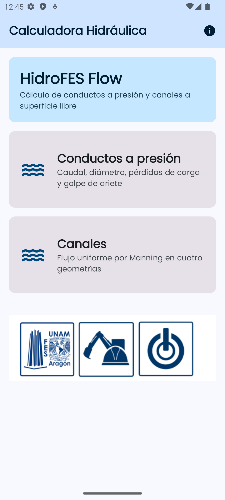
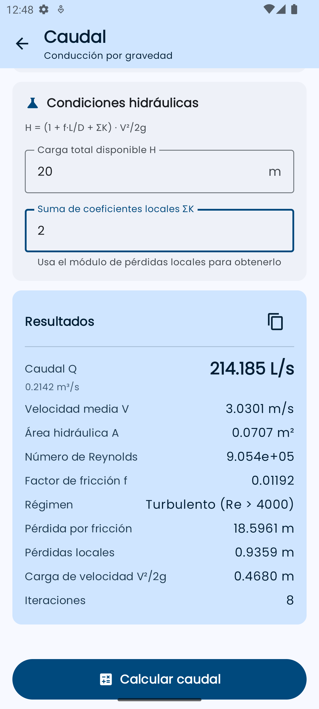
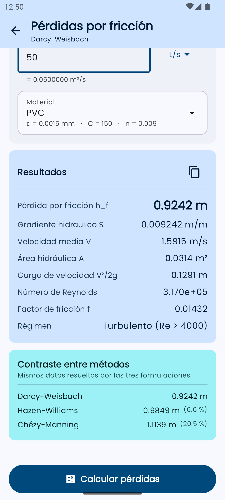
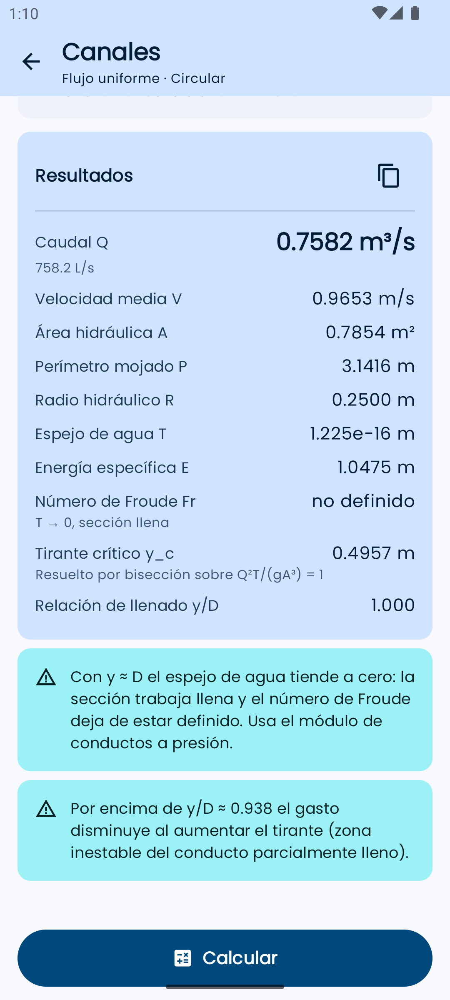

# HidroFES Flow

Calculadora hidráulica para Android. Resuelve conductos a presión y canales a superficie libre con las formulaciones que se usan en los cursos de hidráulica de la **UNAM FES Aragón**.

Versión actual: **2.0**. Escrita por completo en **Kotlin** y **Jetpack Compose**. El cálculo vive en un módulo de dominio sin dependencias de Android y está cubierto por pruebas unitarias.

| | |
|---|---|
| Plataforma | Android 7.0 o superior (`minSdk` 24) |
| Identificador | `com.example.calculotuberias.v2` |
| Lenguaje | Kotlin 2.0, Jetpack Compose, Material 3 |
| Fluido de cálculo | Agua a 20 °C, unidades del SI |

<p>
  
  
  
  
</p>

## Qué calcula

**Conductos a presión**

- **Caudal.** Gasto que circula por un diámetro conocido bajo una carga disponible.
- **Diámetro.** Diámetro necesario para conducir un gasto por gravedad.
- **Pérdidas por fricción.** Darcy-Weisbach, Hazen-Williams y Chézy-Manning, con los tres resultados a la vez para contrastarlos.
- **Pérdidas locales.** Válvulas, codos, tes y entradas, por el método del coeficiente K.
- **Celeridad.** Onda de presión de Allievi-Korteweg, tiempo crítico y sobrepresión de Joukowsky.

**Canales**

- Flujo uniforme de Manning en sección rectangular, triangular, trapezoidal y circular.
- Número de Froude, régimen, energía específica y tirante crítico.

La deducción de cada fórmula, las tablas de materiales y un ejemplo numérico resuelto están en [docs/CALCULOS.md](docs/CALCULOS.md). El uso pantalla por pantalla está en [docs/GUIA_DE_USO.md](docs/GUIA_DE_USO.md). La misma guía, resumida, se abre dentro de la app con el icono de información.

## Cómo se usa

1. Elige **Conductos a presión** o **Canales**.
2. Escribe los datos. La longitud y el caudal aceptan unidad (`mm`, `m`, `in`, `L/s`, `m³/h`, …); el valor que aparece debajo del campo ya está convertido al SI.
3. Elige el material. Cada uno trae juntos la rugosidad ε, el coeficiente C de Hazen-Williams y el n de Manning.
4. Pulsa calcular. El panel distingue tres situaciones: todavía no hay cálculo, los datos no son válidos, o hay un resultado con advertencias.
5. El icono de copiar guarda el resultado en el portapapeles.

El botón de calcular permanece desactivado hasta que todos los campos obligatorios tienen un número. Se acepta punto o coma decimal.

## Compilar

Hace falta JDK 17 (el que trae Android Studio sirve) y el Android SDK con la plataforma 35.

```bash
export JAVA_HOME="/Applications/Android Studio.app/Contents/jbr/Contents/Home"
./gradlew assembleDebug
./gradlew testDebugUnitTest
```

El APK de depuración queda en `app/build/outputs/apk/debug/app-debug.apk`.

El identificador `com.example.calculotuberias.v2` permite instalar esta versión junto a la 1.0 en el mismo dispositivo.

## Cómo está organizado el código

```
app/src/main/java/com/example/calculotuberias/
├── domain/        Cálculo puro: fórmulas, catálogos y unidades. Sin Android.
├── ui/screens/    Una pantalla y su ViewModel por módulo.
├── ui/components/ Campos, tarjetas y el panel de resultados.
├── ui/theme/      Esquema Material 3 claro y oscuro.
└── navigation/    Rutas con seguridad de tipos.
```

El detalle de cada paquete y la forma de añadir un módulo nuevo están en [docs/ARQUITECTURA.md](docs/ARQUITECTURA.md).

Las pruebas viven en `app/src/test/` y comprueban el dominio contra soluciones de referencia: Colebrook-White, la forma clásica de Korteweg, el tirante crítico rectangular en forma cerrada y el cierre del círculo caudal → diámetro.

## Constantes

Agua a 20 °C, las mismas en todos los módulos:

| Símbolo | Valor | Unidad |
|---|---|---|
| g | 9.81 | m/s² |
| ρ | 998 | kg/m³ |
| ν | 1.004×10⁻⁶ | m²/s |
| K | 2.19×10⁹ | Pa |

## Alcance

Los métodos empíricos tienen un intervalo de validez y la app lo señala en pantalla cuando la entrada se sale de él:

- Hazen-Williams está pensado para agua, diámetros de al menos 50 mm y velocidades entre 0.6 y 3 m/s.
- Con Reynolds entre 2300 y 4000 el factor de fricción se interpola: en esa zona no hay una ley única.
- En un conducto circular con tirante igual al diámetro el espejo de agua se anula y el número de Froude deja de estar definido.
- Los coeficientes de los catálogos son los de las tablas del proyecto académico. Dos de ellos se apartan de los valores de manual más citados: n = 0.022 para hierro dúctil y n = 0.010 para acero remachado.

## Documentación

| Documento | Contenido |
|---|---|
| [Guía de uso](docs/GUIA_DE_USO.md) | Qué pide cada pantalla y cómo leer el resultado |
| [Cálculos](docs/CALCULOS.md) | Fórmulas, tablas, ejemplo resuelto y pruebas |
| [Arquitectura](docs/ARQUITECTURA.md) | Paquetes, flujo de datos y cómo extender la app |

## Créditos

Proyecto académico de la Universidad Nacional Autónoma de México, Facultad de Estudios Superiores Aragón.
